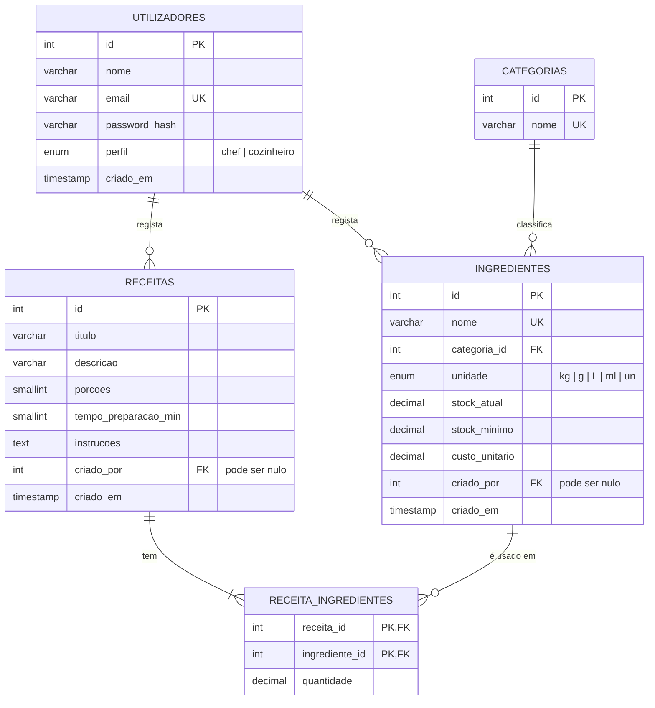

# Chefy — Base de Dados

Sistema: MySQL / MariaDB (InnoDB, `utf8mb4`). Script completo: [`sql/schema.sql`](../sql/schema.sql). Dados de teste: [`sql/dados_exemplo.sql`](../sql/dados_exemplo.sql).

## 1. Diagrama Entidade-Relação

> O diagrama é desenhado com Mermaid: o GitHub mostra-o automaticamente. Para o relatório
> pode exportar-se como imagem em <https://mermaid.live> (colar o bloco acima).

## 2. Explicação das tabelas

| Tabela | Para que serve | Notas |
|---|---|---|
| `utilizadores` | Pessoas que entram na aplicação. | A password nunca é guardada: só o **hash** (`password_hash`). O `email` é único. `perfil` (chef/cozinheiro) fica preparado para a gestão de privilégios da entrega final. |
| `categorias` | Lista fixa para classificar ingredientes (Carnes, Peixe e marisco, …). | Evita escrever a categoria à mão (e erros como «Carne» / «carnes»). |
| `ingredientes` | Inventário da cozinha: stock atual, stock mínimo, unidade e custo. | `stock_atual <= stock_minimo` (com mínimo > 0) = **stock baixo**. |
| `receitas` | Livro de receitas: título, porções, tempo e instruções. | |
| `receita_ingredientes` | Liga receitas e ingredientes e guarda **quanto** de cada um. | Tabela de ligação da relação N:M. |

## 3. Relações

| Relação | Tipo | Como se implementa |
|---|---|---|
| Categoria → Ingredientes | 1 : N | `ingredientes.categoria_id` → `categorias.id` |
| Utilizador → Ingredientes / Receitas | 1 : N | `criado_por` → `utilizadores.id` (nulo permitido) |
| Receitas ↔ Ingredientes | **N : M** | Uma receita leva vários ingredientes e um ingrediente aparece em várias receitas → tabela `receita_ingredientes` com chave primária composta `(receita_id, ingrediente_id)` |

## 4. Regras de integridade (feitas pela própria BD)

| Regra | Mecanismo | Efeito na aplicação |
|---|---|---|
| Não pode haver dois utilizadores com o mesmo email, nem dois ingredientes com o mesmo nome | `UNIQUE` | Mensagem «Já existe…» |
| Um ingrediente não se apaga se estiver numa receita | `ON DELETE RESTRICT` em `receita_ingredientes.ingrediente_id` | «Não é possível apagar: usado em receitas» |
| Ao apagar uma receita desaparecem as suas linhas de ingredientes | `ON DELETE CASCADE` em `receita_ingredientes.receita_id` | Sem registos órfãos |
| Se um utilizador é apagado, o que registou mantém-se | `ON DELETE SET NULL` em `criado_por` | |
| Valores não negativos / quantidade > 0 / porções ≥ 1 | `CHECK` | Segunda barreira, além da validação em PHP |
| A mesma receita não repete o mesmo ingrediente | Chave primária composta | |

## 5. Normalização

- **1FN:** todos os campos são atómicos (não há listas dentro de uma coluna; os ingredientes de uma receita estão em linhas separadas).
- **2FN:** em `receita_ingredientes` o único atributo não-chave (`quantidade`) depende da chave composta inteira.
- **3FN:** a categoria está numa tabela própria (o nome da categoria não se repete em cada ingrediente) e não há atributos que dependam de outros atributos não-chave.

## 6. Decisões de desenho

- **`DECIMAL` e não `FLOAT`** para stock e custos: evita erros de arredondamento em dinheiro.
- **A quantidade de uma receita usa a unidade do próprio ingrediente** (0,5 kg de farinha; 3 un de ovos). Evita uma tabela de conversão de unidades, que fica como possível evolução.
- **`ENUM` para a unidade:** lista curta e estável. Se crescesse, passaria a tabela própria.
- **Índices:** além das chaves, `idx_receitas_titulo` e os índices das chaves estrangeiras aceleram pesquisas e *joins*.

## 7. Acesso seguro e abstrato à BD (ficheiro `includes/db.php`)

- Toda a aplicação usa **PDO** com *prepared statements* reais (`ATTR_EMULATE_PREPARES = false`): o SQL e os valores viajam separados, o que impede **SQL Injection**.
- As páginas não falam com o PDO diretamente: usam 4 funções (`db_todos`, `db_um`, `db_executar`, `db_ultimo_id`). Se um dia mudarmos de motor ou de biblioteca, só se altera este ficheiro.
- Operações com várias escritas (guardar uma receita e as suas linhas) correm numa **transação**: ou grava tudo, ou nada.
- Os erros SQL não se mostram ao utilizador em produção (`mostrar_erros = false`).
